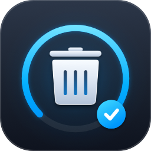

<div align="center">
  
  <h1>ZeroTrash</h1>
  <p><strong>Next-generation cross-platform application uninstaller, leftover scanner &amp; Pro system cleaner.</strong></p>
  <p>Built with <strong>Rust</strong>, <strong>Tauri v2</strong>, and <strong>React / TypeScript</strong> — engineered for speed, safety, and complete local privacy.</p>

  <p>
    <a href="https://github.com/zerotrashapp/zerotrash/releases/latest"></a>
    
    
    
    
  </p>
</div>

---

## Download

Grab the latest installer for your operating system from the [**Releases Page**](https://github.com/zerotrashapp/zerotrash/releases/latest):

| Platform | Architecture / Format | Download |
| :--- | :--- | :--- |
| **macOS** | Apple Silicon (`M1`–`M4`, `.dmg`) | [ZeroTrash_1.0.0_aarch64.dmg](https://github.com/zerotrashapp/zerotrash/releases/latest/download/ZeroTrash_1.0.0_aarch64.dmg) |
| **macOS** | Intel (`x86_64`, `.dmg`) | [ZeroTrash_1.0.0_x64.dmg](https://github.com/zerotrashapp/zerotrash/releases/latest/download/ZeroTrash_1.0.0_x64.dmg) |
| **Windows** | 64-bit Installer (`.exe`) | [ZeroTrash_1.0.0_x64-setup.exe](https://github.com/zerotrashapp/zerotrash/releases/latest/download/ZeroTrash_1.0.0_x64-setup.exe) |
| **Windows** | 64-bit MSI Package (`.msi`) | [ZeroTrash_1.0.0_x64_en-US.msi](https://github.com/zerotrashapp/zerotrash/releases/latest/download/ZeroTrash_1.0.0_x64_en-US.msi) |
| **Linux** | AppImage (`x86_64`) | [ZeroTrash_1.0.0_amd64.AppImage](https://github.com/zerotrashapp/zerotrash/releases/latest/download/ZeroTrash_1.0.0_amd64.AppImage) |
| **Linux** | Debian / Ubuntu (`.deb`) | [ZeroTrash_1.0.0_amd64.deb](https://github.com/zerotrashapp/zerotrash/releases/latest/download/ZeroTrash_1.0.0_amd64.deb) |
| **Linux** | Fedora / RHEL (`.rpm`) | [ZeroTrash-1.0.0-1.x86_64.rpm](https://github.com/zerotrashapp/zerotrash/releases/latest/download/ZeroTrash-1.0.0-1.x86_64.rpm) |

> **macOS Note:** Since the community build is ad-hoc signed, if macOS Gatekeeper warns on first launch, drag `ZeroTrash.app` to `/Applications` and run `xattr -cr /Applications/ZeroTrash.app` in Terminal (or right-click → **Open**).

## Overview

**ZeroTrash** replaces bloated, subscription-heavy system cleaners with a fast, transparent, locally-executed Rust engine and a modern native desktop interface. Whether you want one-click cleanup in **Simple Mode** or granular control in **Pro Mode**, ZeroTrash finds deep application leftovers, hidden disk hogs, and AI model caches without ever sending your data off-device.

## Key Features

### Core Cleaning & Uninstallation
- **Deep Application Uninstaller**: Scans installed apps, inspects Mach-O architectures (`arm64`, `x86_64`, `Universal` on macOS), and maps all associated files across `Application Support`, `Caches`, `Preferences`, `Containers`, `Group Containers`, `Saved Application State`, `LaunchAgents`, `LaunchDaemons`, and installer receipts.
- **Orphaned Data Scanner**: Cross-references user `Library` directories against installed bundle IDs to detect leftover folders from previously removed apps.
- **Developer Caches Cleaner**: Safely targets build artifacts from Xcode (`DerivedData`), Cargo, npm, Gradle, CocoaPods, pip, and Homebrew.
- **Space Lens & Large/Old Files**: Visual storage breakdown and instant filtering for oversized or forgotten files.
- **Duplicate Finder & File Shredder**: Byte-level duplicate detection and multi-pass secure file erasure.
- **Startup & Background Services**: Inspects `LaunchAgents`, `LaunchDaemons`, and startup entries with live PID correlation and toggle support.
- **Universal Binary Slimmer** *(macOS)*: Strips unused CPU architectures from Universal Mach-O binaries to reclaim disk space safely.
- **Trash History & Restore** *(macOS)*: Tracks deleted items and allows quick restoration when needed.

### Exclusive Pro Tools
| Tool | What It Does |
| :--- | :--- |
| **AI Model Vault** | Discovers local LLM & ML weights/caches (Ollama, HuggingFace, LM Studio, Whisper, PyTorch, CoreML) and frees gigabytes cleanly. |
| **Ghost Space Radar** | Surfaces hidden disk consumers (APFS & Time Machine local snapshots, Docker VM disks, Xcode Simulators, `/private/var/vm`) with safe reclamation guidance. |
| **Telemetry & Privacy Shield** | Audits crash reports, diagnostic logs, browser tracking caches, and third-party telemetry daemons. |
| **App Time-Capsule** | Creates lightweight local snapshots of an app's support & preference state before updates or resets, with 1-click restore. |

### Built for Every Workflow
- **Simple Mode & Pro Mode**: Start with clean **Quick-Start Smart Care** cards, or toggle **Pro Tools** in the sidebar for full power-user modules.
- **Command Palette (`Cmd + K` / `Ctrl + K`)**: Jump instantly to any scanner, tool, or action from the keyboard.
- **Export Audit Report (Save As)**: Generate and save full system audit reports anywhere on disk using your OS's native file dialog.

## Platform Support

| Module | macOS | Linux | Windows |
| :--- | :---: | :---: | :---: |
| App Uninstaller & Deep Scan | Full | `.desktop` entries | Registry Uninstall keys |
| Startup Items, Caches, Space Lens, Shredder | Full | Full | Full |
| Exclusive Pro Tools (AI Vault, Ghost Space, Telemetry, Time-Capsule) | Full | Full | Full |
| Native Save As Dialog | AppleScript | `zenity` / `kdialog` | PowerShell `SaveFileDialog` |
| Orphaned Data, Package Managers, Duplicates, Trash History, Universal Slimmer | Full | Planned | Planned |

## Architecture & Security

- **100% Local Execution**: All scanning, hashing, and cleanup run locally via the compiled Rust binary (`zerotrash-cli`). No telemetry, no cloud uploads.
- **Hardened Local Bridge**: The standalone local HTTP bridge enforces loopback-only `Host` and `Origin` validation, strict `application/json` checks on `/api/*` endpoints, request size limits, and canonicalized static asset serving.
- **Safe Defaults**: High-risk system/VM targets (e.g., live Docker disk images, `/private/var/vm`, active Simulator devices) are protected from blind 1-click deletion and paired with safe CLI/UI hints.

## Quick Start (Development)

```bash
# 1. Install frontend dependencies
npm install

# 2. Build the standalone Rust CLI engine
cd src-tauri
cargo build --release --bin zerotrash-cli --no-default-features

# 3. Start the Vite dev server (or launch the native Tauri window)
cd ..
npm run dev
# or:
npm run tauri:dev
```

## Production Build & Releases

```bash
npm run build
npm run tauri:build
```

Automated multi-platform builds for **macOS** (`.dmg` — Apple Silicon & Intel), **Windows** (`.exe` / `.msi`), and **Linux** (`.deb` / `.AppImage`) are configured in [`.github/workflows/release.yml`](.github/workflows/release.yml).

## Contributing & Bug Reports

Found a bug or have a feature idea? Open an issue via the built-in **Report Bug** button in ZeroTrash or directly on [GitHub Issues](https://github.com/zerotrashapp/zerotrash/issues).

## License

Released under the [MIT License](LICENSE).
